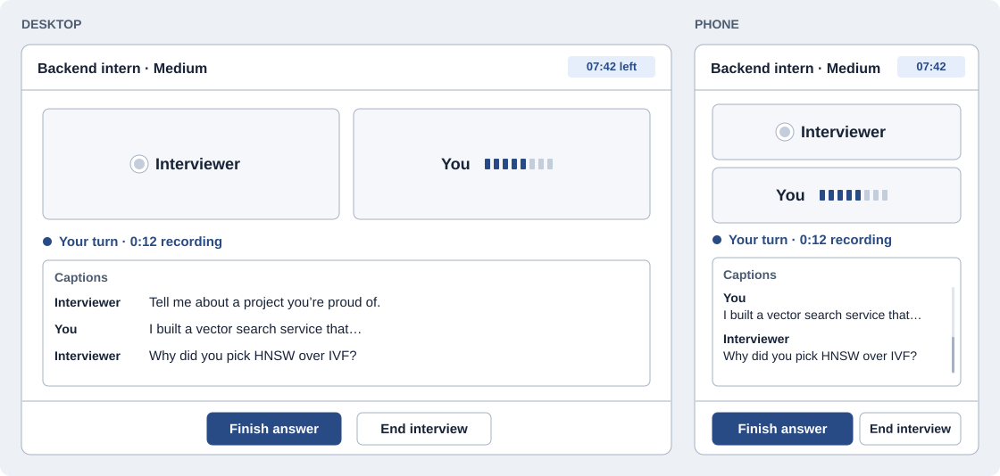
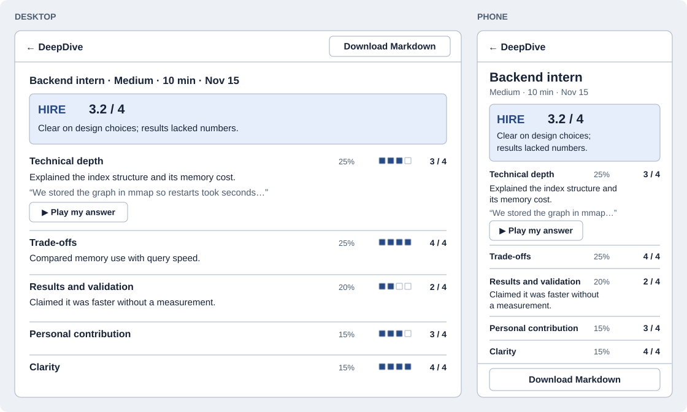

# Wireframes

Low-fidelity layouts for the four pages. Field names match `shared/src/` (REST DTOs and WebSocket messages).
Desktop first, then phone (one column, controls pinned to the bottom).

| Page | Route | Data |
|---|---|---|
| Home (start + history) | `/` | `GET /api/interviews`, `DELETE /api/interviews/:id` |
| Setup | `/setup` | `POST /api/interviews` |
| Meeting Room | `/interviews/:id/room` | `GET /api/interviews/:id`, WebSocket `/ws/interviews/:id` |
| Report | `/interviews/:id/report` | `GET /api/interviews/:id/report`, `GET /api/interviews/:id`, `GET /api/turns/:id/audio` |

## 1. Home

History is a section of Home, not a separate page, so the app keeps four pages.

Phone: the table becomes a list of cards.

- **Result column** comes from `InterviewListItem.status`: `DONE` → `overallScore` + `verdict`; `SCORING` → "Scoring…"; `FAILED` → "Failed"; `CREATED` / `LIVE` → "Unfinished".
- **Delete** (✕) opens a confirm dialog ("Delete this interview and its recordings?"), then calls `DELETE`.
- **Empty state:** "No interviews yet." under the heading.

## 2. Setup

Every field has a default, so the shortest path is: type nothing, click **Start** (two clicks from Home).

Phone: same fields stacked; **Start interview** pinned to the bottom, full width.

- **Microphone check** asks for permission (`getUserMedia`) and shows a live level bar. If permission is denied: "Microphone blocked. Allow it in the browser settings, then test again." **Start** stays disabled until the check passes.
- **Start** → `POST /api/interviews` → navigate to `/interviews/:id/room`. On error, show the message under the button; the form keeps its values.

## 3. Meeting Room

Like a video call: two tiles, captions, a control bar. No avatar; the interviewer tile is a name plate with a speaking ring.

Phone: tiles stacked and shorter; captions scroll in the middle; control bar pinned to the bottom.

What each `RoomState` looks like:

| State | Status label | Ring | Microphone | Finish answer |
|---|---|---|---|---|
| before start (`CREATED`) | "Ready when you are" + big **Begin** button | off | off | hidden |
| `speaking` | "Interviewer is speaking" | pulsing | off | disabled |
| `thinking` | "Thinking…" (spinner) | off | off | disabled |
| `listening` | "Your turn" + recording time | off | **on** (level bar) | enabled |
| `ended` | "Interview finished. Scoring your answers…" | off | off | hidden |

- **Begin** sends `interview.start`. The click also unlocks browser audio, so interviewer speech can play.
- **Captions** append every `caption` message (both speakers), in `turn.index` order.
- **Timer** counts down from `startedAt + durationMin`.
- **End interview** asks "End now? Your answers so far will be scored." then sends `interview.end`.
- **`report.ready`** → navigate to the report page. If the socket closes during `ended`, the page polls `GET /api/interviews/:id` and navigates when `status` is `DONE`.
- **Errors** show a banner above the control bar with `message`; if `retryable`, a **Retry** button resends the same recording.
- Opening the room of a `DONE` interview redirects to its report.

## 4. Report

Verdict first, then evidence per skill.

Phone: same order in one column; **Download Markdown** moves to the bottom.

- **Play my answer** appears only when `turnId` is set; it calls `GET /api/turns/:id/audio` and plays the URL in an `<audio>` element.
- **Download Markdown** builds the file in the browser from the loaded report (no extra endpoint).
- **While scoring** (`409`): "Scoring your answers…" with a spinner; poll every 3 s.
- **Failed** (`status: FAILED`): "Scoring failed." + **Score again** (endpoint still open; see `docs/design.md`).
- **Not found** (`404`): "Interview not found." + link to Home.
