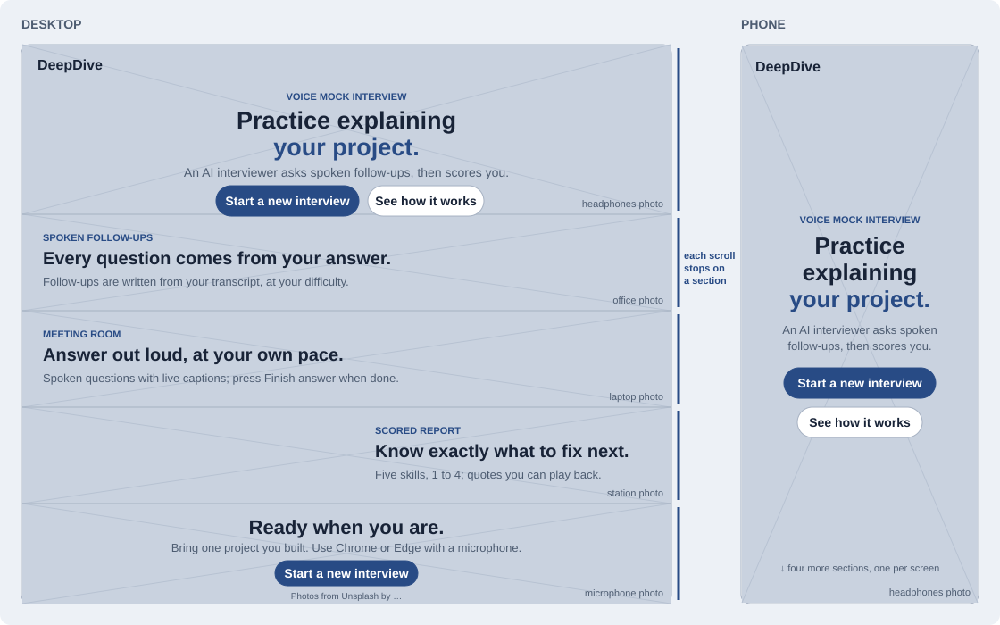
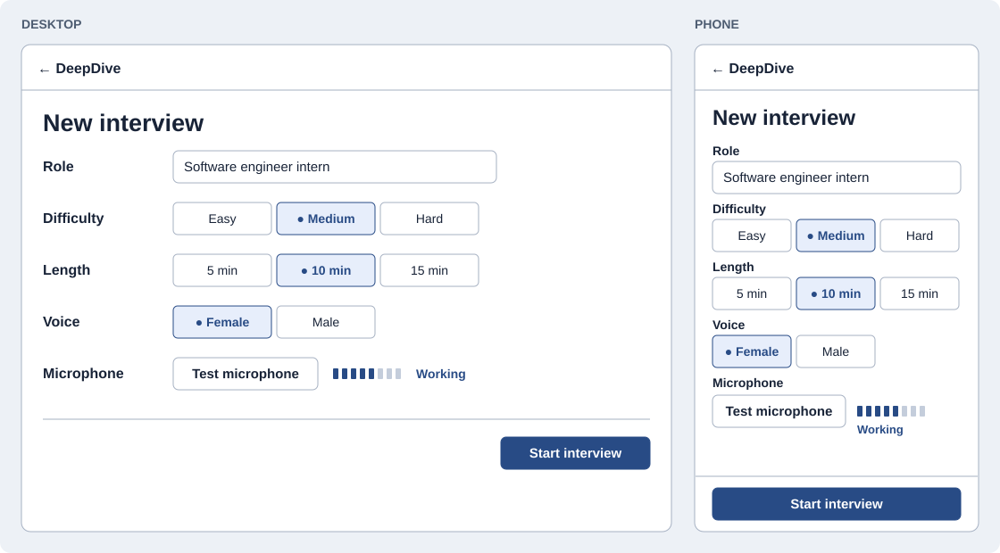

# Wireframes

Low-fidelity layouts for the four pages. Field names match `shared/src/` (REST DTOs and WebSocket messages).
Desktop first, then phone (one column, controls pinned to the bottom).

| Page | Route | Data |
|---|---|---|
| Home (product introduction) | `/` | none (static page) |
| Setup (new interview + past interviews) | `/setup` | `POST /api/interviews`, `GET /api/interviews`, `DELETE /api/interviews/:id` |
| Meeting Room | `/interviews/:id/room` | `GET /api/interviews/:id`, WebSocket `/ws/interviews/:id` |
| Report | `/interviews/:id/report` | `GET /api/interviews/:id/report`, `GET /api/interviews/:id`, `GET /api/turns/:id/audio` |

## 1. Home

A product introduction in five full-screen sections, each over a black-and-white photo tinted navy. Each scroll stops on the next section (CSS scroll snapping, home page only); there are no other scroll effects.

Phone: the same sections in one column; buttons stack.

1. **Hero:** "Practice explaining your project." + *Start a new interview* (→ Setup) and *See how it works* (→ section 2).
2. **Spoken follow-ups:** every question is written from the candidate's transcript, at the chosen difficulty.
3. **Meeting room:** spoken questions with live captions; nobody cuts you off, *Finish answer* ends an answer.
4. **Scored report:** five skills scored 1 to 4, quotes that play back, Markdown download.
5. **Ready when you are:** what to bring (one project, Chrome or Edge, a microphone) + *Start a new interview*. The photo credits (Unsplash) sit at the bottom.

The text only describes features that work. Past interviews moved to the Setup page (section 2), so the app still has four pages.

## 2. Setup

Every field has a default, so the shortest path is: type nothing, click **Start** (two clicks from Home). Past interviews are listed below the form.

Phone: same fields stacked; past interviews become cards; **Start interview** pinned to the bottom, full width.

- **Microphone check:** *Test microphone* asks for permission (`getUserMedia`) and shows a level bar that moves only during the test; the button turns into *Finish test*, which releases the microphone. The bar shows loudness in decibels (-50 dB empty, -10 dB full), rises quickly and falls slowly, so it follows the voice without flickering. If permission is denied: "Microphone blocked. Allow it in the browser settings, then test again." **Start** stays disabled until the check passes.
- **Start** → `POST /api/interviews` → navigate to `/interviews/:id/room`. On error, show the message under the button; the form keeps its values.
- **Past interviews:** a table on desktop, cards on phones. Clicking a row opens its report, or its room if unfinished.
  - **Result column** comes from `InterviewListItem.status`: `DONE` → `overallScore` + `verdict`; `SCORING` → "Scoring…"; `FAILED` → "Failed"; `CREATED` / `LIVE` → "Unfinished".
  - **Delete** (✕) opens a confirm dialog ("Delete this interview and its recordings?"), then calls `DELETE`.
  - **Empty state:** "No interviews yet." under the heading.

## 3. Meeting Room

Like a video call: two tiles, captions, a control bar. No avatar; each tile is an icon and a name. Before *Begin*, a waiting card replaces the call (below).

Phone: tiles stacked and shorter; captions scroll in the middle; control bar pinned to the bottom.

What each `RoomState` looks like:

| State | Status label | Blue outline | Microphone | Finish answer |
|---|---|---|---|---|
| before start (`CREATED`) | waiting card only: role · difficulty · length, "Ready when you are." + **Begin** | none | off | hidden |
| `speaking` | "Interviewer is speaking" | interviewer tile | off | disabled |
| `thinking` | "Thinking…" (spinner) | none | off | disabled |
| `listening` | "Your turn" + recording time | your tile | **on** (red mic icon) | enabled |
| `ended` | "Interview finished. Scoring your answers…" | off | off | hidden |

- The outline marks who is speaking: the interviewer while their audio plays, the candidate while the microphone records. It switches on and off without animation.
- **Begin** sends `interview.start`. The click also unlocks browser audio, so interviewer speech can play. Reopening a running interview shows the same card with "Your interview is still running." and **Resume interview**. The call opens directly, with no countdown or entrance effect.
- **Captions** append every `caption` message (both speakers), in `turn.index` order.
- **Timer** counts down from `startedAt + durationMin`.
- **End interview** asks "End now? Your answers so far will be scored. The answer you are giving now is not included." then sends `interview.end`.
- **After `ended`**, once the closing words have played: `report.ready`, `SCORING_FAILED` or a closed socket → navigate to the report page, which polls while scoring.
- **Errors** show a banner above the control bar with `message`; if `retryable`, a **Retry** button resends the same recording (`STT_FAILED`) or reconnects (`LLM_FAILED`, lost connection).
- Opening the room of a `SCORING`, `FAILED` or `DONE` interview redirects to its report.

## 4. Report

Verdict first, then evidence per skill.

Phone: same order in one column; **Download Markdown** moves to the bottom.

- **Play my answer** appears only when `turnId` is set and that turn has a recording (`hasAudio`); it calls `GET /api/turns/:id/audio` and plays the URL in an `<audio>` element.
- **Download Markdown** builds the file in the browser from the loaded report (no extra endpoint).
- **While scoring** (`409`): "Scoring your answers…" with a spinner; poll every 3 s.
- **Failed** (`status: FAILED`): "Scoring failed." + **Score again**, which calls `POST /api/interviews/:id/report` and then polls.
- **Not found** (`404`): "Interview not found." + link to Home.
